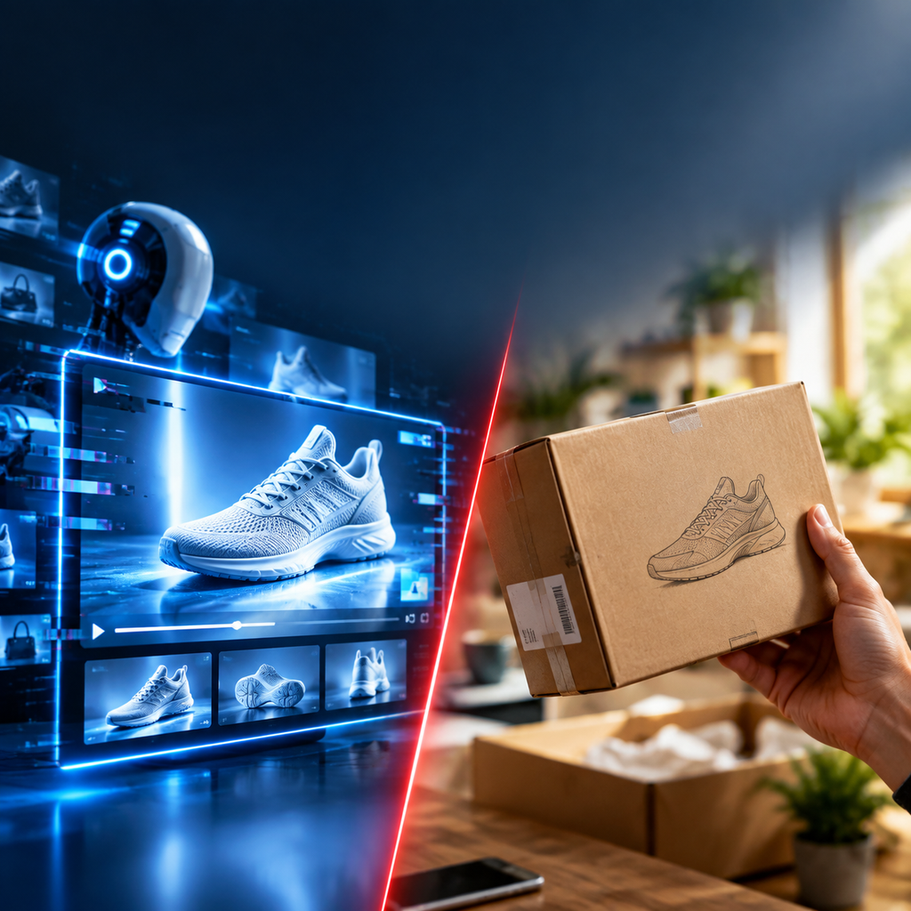
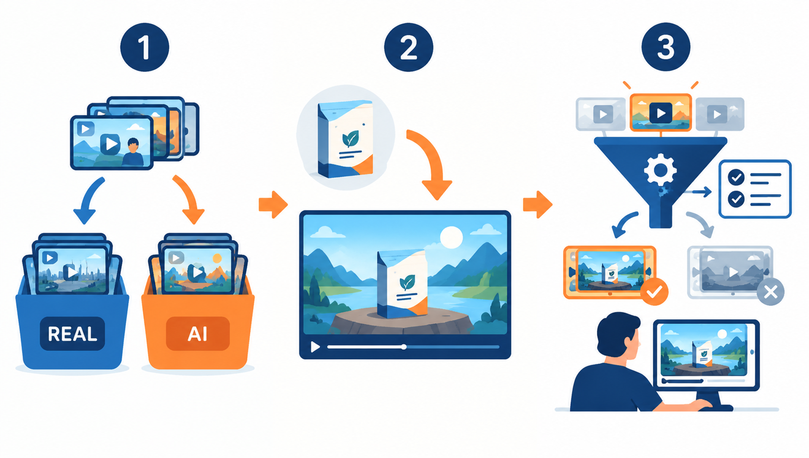
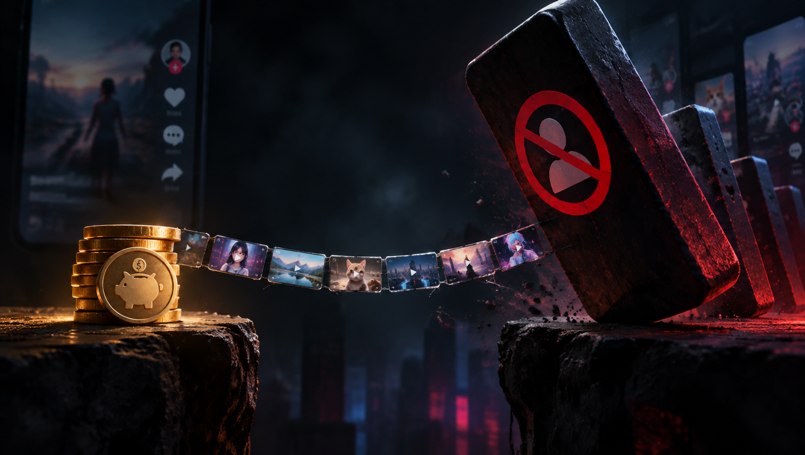

# AI 视频不是不能用，是不能「全靠 AI」

全 AI 出片每月能省 1 万块，但它可能一次罚掉你月销 20 万美元的账号。

单条省 100–200 元，是线性成本；账号没了，是非线性风险。"AI 视频省多少钱"这个算法，少了另一半。

我把自己的工作流拆了一遍，发现只需要动 3 个环节，就能把风险压下来。

## 一、把镜头分成两类，而不是分成「能省」和「不能省」

我现在按「观众会不会认为是假的」来分，不按成本分：

**必须真人拍的**：真人出镜口播、产品实际使用、开箱、任何需要证明「这个东西真实存在」的镜头。

**可以交给 AI 的**：场景铺陈、氛围镜头、多语言版本、同一素材的批量变体。

分界线很清楚——**镜头里有没有一个需要被相信的「人」或「物」**。有，就真人；没有，AI 随便跑。

## 二、给 AI 素材留一个可验证的锚点

纯 AI 生成的画面有个特征：没有任何可被核实的信息。我在每条 AI 素材里强制加一个真实元素——真实的产品包装、真实的使用场景截图、或者一个真人手部动作。

这不是为了骗过审核，而是让素材本身经得起看。平台的判罚逻辑通常是「这条内容是否真实反映商品」，有一个真实锚点，你就站在说得清的那一侧。

## 三、出片速度和审片速度要匹配

这是最容易忽略的一点。剪映刚发的「小映」能把多轨剪辑交给 Agent，批量出片速度上来了，但如果你的审片还是人工一条条看，产能全卡在最后一步。

我的做法是给 AI 素材定三条硬规则（时长区间、必含元素、禁止出现的内容），用规则先筛一遍，人只看通过规则的那一批。

## 说回成本

改造完之后我的单条成本大概是纯 AI 方案的 1.6 倍，但比全真人拍摄还是低很多。

更重要的是：我不再需要每天担心哪个账号明天会没。

如果你也在用 AI 出素材，建议先做第一步——把手上所有镜头按「有没有需要被相信的人或物」过一遍。这一步 10 分钟就能做完，但它会告诉你，你的风险敞口到底有多大。
