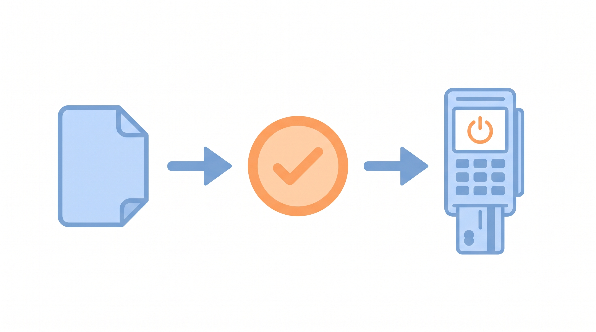
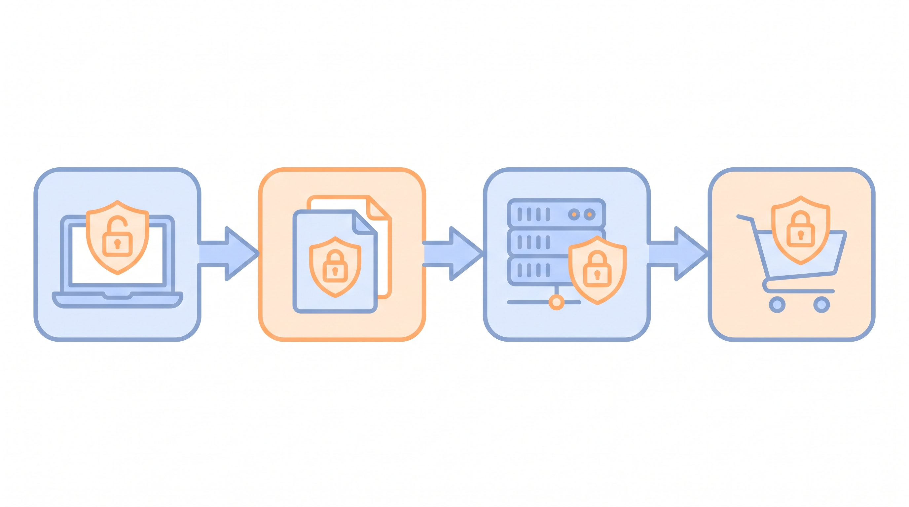

# Shopify 放出 AI Toolkit：AI 能直接改店铺了，但先别急着上生产

> 摘要：Shopify 在 2026 年 4 月推出开源的 AI Toolkit，让 Claude Code、Cursor、Codex、VS Code 等 AI 工具能读取官方文档、校验 GraphQL/Liquid/扩展代码，并通过 CLI 在授权后操作店铺。本文说明它真正改变什么、哪个场景最值得先试、以及上生产前必须补的治理。

AI 写 Shopify 代码最常见的失败不是语法，而是“看着对、跑起来错”。

字段名对不上、API 版本已弃用、Liquid 对象层级猜错——generic AI 很难靠自己解决这些问题。Shopify 最近把这件事当成基础设施来修：推出 AI Toolkit，把官方文档、API schema 和受控的 CLI 权限一起交给 AI agent。

agent 从“背答案”变成“查答案”，差别就在这里。这不是说 AI 不会再错，而是错的类型从“平台上下文错”变成“业务判断错”，后者本来就是人该管的部分。

过去你要在浏览器、文档、CLI 之间切来切去；现在 agent 能在同一上下文里查文档、对 schema、生成请求。这对每季度发布新 API 版本的 Shopify 格外有用，因为训练数据永远追不上最新 schema。

## 它到底给了什么

AI Toolkit 的核心可以拆成三块。

第一，**文档与 schema 接入**。Claude Code、Cursor、Codex、VS Code 等支持的 AI 工具，可以直接查询 Shopify 开发者文档和当前 API schema，而不是靠训练记忆猜字段关系。对 Shopify 这种每季度更新 API 版本的平台来说，这一点很关键。

更具体地说，agent 可以 introspect GraphQL schema，直接看到某个 mutation 需要哪些必填字段、返回值是什么类型。REST 端点同理。你拿到的不只是“看起来像 Shopify 的代码”，而是和当前平台 contract 对齐的请求。

第二，**代码校验**。生成的 GraphQL 查询、Liquid 模板、UI extension 代码会先跑一遍 Shopify schema 检查，提前发现弃用字段、类型不匹配、参数错误。它不能替代单元测试，但能把很多“运行时才暴露”的问题前置到编辑器里。

比如你用 AI 生成一段 GraphQL 查询，Toolkit 会立刻指出字段是否已弃用、参数类型是否匹配、Liquid 对象是否在当前主题版本存在。它不是编译器，但能把集成错误提前到提交之前。

第三，**Store execute**。通过 Shopify CLI 的认证上下文，agent 可以在你确认后执行店铺操作，比如创建测试商品、更新 metafield、改主题片段、批量调库存。这里的关键词是“在你确认后”——不是 agent 自动跑生产。

注意，这种执行不是无限制的。你需要先通过 `shopify auth login` 完成 CLI 认证，agent 才能调用 store execute；而且每次执行都在你的 Shopify CLI 会话上下文中，权限由你分配的 token scope 决定。

安装方式有三种：插件（自动更新，推荐）、手动添加单个 skill、或者通过 Dev MCP server 接入。项目是 MIT 开源，代码在 Shopify 的 GitHub 仓库里。

Toolkit 不替你写业务逻辑，也不保证生成的代码一定符合你的品牌规则或性能要求。它减少的是平台上下文缺失导致的返工，而不是所有返工。

## 谁该现在关注

三类团队会最敏感。

开发者与 agency：如果你每天都在查 Admin API 文档、试字段、对 SDK 版本，Toolkit 能减少很多返工。

运营技术：批量 SEO 标题、metafield 同步、折扣码生成这类脚本，可以让 agent 先写、先校验，再拿到 staging 跑。

有迁移债的团队：checkout 和客户账户 UI extension 在 2025-10 之前版本需要升级到 Polaris web components，这是 Shopify 官方举的典型用例。

这三类人的共同点是：问题不是“不会写代码”，而是“写的代码和 Shopify 当前平台状态对不上”。Toolkit 解决的是上下文对齐问题，而不是替代人的判断力。

## 一个最值得先试的场景

以 checkout UI extension 迁移为例。

旧流程是手动改 `shopify.extension.toml`、把 React 代码转成 Preact、替换 legacy 组件、核对迁移指南，最后本地跑测。步骤重复、细节多、容易漏。

装了 Toolkit 后，你可以直接让 agent：把 `extensions/my-checkout-extension` 迁移到 2026-04 版本。agent 会按官方迁移指南生成修改，你 review diff、本地测试、确认没问题再合并。

假设你的扩展用到了老版 `Modal` 和 `Button` 组件。agent 会提示把它们替换成 Polaris web components 的对应组件，同时把 `shopify.extension.toml` 里的 `api_version` 从 `2025-07` 改成 `2026-04`，并更新 target 映射。原本要手动核对十几处细节，现在由 schema 和迁移指南驱动。

它能省的是重复劳动，不是责任。官方文档明确说：你仍然需要测试、review 和验证行为。

## 安全与治理：比“能不能做”更重要

Store execute 方便，但也把“改店铺”的按钮放到了 AI 工作流里。governance 要提前做。

权限最小化。给 agent 的 token 只开当前任务需要的 scope，生产与 staging 分离，短期 token 定期轮换。

执行要可控。store execute 需要你确认，但当前版本不支持自动回滚。任何影响库存、价格、结账流程的操作，先在 dev store 跑通。理想情况下，脚本要先支持 dry-run：只校验、不写入，确认影响范围后再真正执行。

留审计日志。记录 agent 身份、命令、参数、返回码；关键脚本进版本控制，走 PR review 和 CI 门禁。

把 Toolkit 的校验能力接进 CI 也很自然：每次提交前自动跑一遍 GraphQL/Liquid 校验， schema 不通过就不合并。这样 agent 生成的代码也要经过和人写代码同样的门禁。

注意自动更新。插件会随 Shopify 更新自动拉新能力，这保证 schema 不过期，但也意味着行为可能变化。敏感环境建议锁定版本或先在 staging 验证。

一个实用的做法是给不同环境配不同更新策略：本地开发用自动更新紧跟官方节奏，staging 延后一周观察社区反馈，生产环境只升级经过你团队验证的版本。

## 怎么开始与要不要跟

前提不高：Node.js 18+，有 Shopify CLI 基础。

试用可以分三步：在 dev store 装插件；跑一个只读查询或非关键迁移草稿；review diff 后在 staging 执行。

判断是否值得跟的信号很简单：如果你团队每周都要查 Shopify API 文档、写重复迁移脚本、做批量 metafield 操作，就值得试点；如果只是偶尔改改主题，优先级可以往后放。

快速 checklist：
- [ ] 有专门的 dev store 和 staging store
- [ ] 已用 Claude Code / Cursor / Codex / VS Code 其中一种 AI 工具
- [ ] 熟悉 Shopify CLI 和 OAuth scope 概念
- [ ] 关键脚本已进版本控制并有人 review
- [ ] 能接受先在非生产环境跑至少两轮再扩大权限

五项全勾，说明你已经准备好从 Toolkit 里拿到实际收益。

AI Toolkit 不是让 AI 替代开发者，而是把 Shopify 平台上下文注入 AI 工作流。省下来的时间，应该花在 review、测试和治理上，而不是用来取消这些步骤。

---

## 参考资料

1. Shopify：《Shopify AI Toolkit》官方文档，https://shopify.dev/docs/apps/build/ai-toolkit
2. Shopify：《Introducing the Shopify AI Toolkit》开发者 changelog，https://shopify.dev/changelog/shopify-ai-toolkit-connect-your-ai-tools-to-the-shopify-platform
3. Shopify/Shopify-AI-Toolkit GitHub 仓库，https://github.com/Shopify/Shopify-AI-Toolkit
4. Shopify-AI-Toolkit LICENSE（MIT），https://raw.githubusercontent.com/Shopify/Shopify-AI-Toolkit/main/LICENSE
5. PowerCommerce：用户提供原文，https://powercommerce.com/blogs/shopify-updates/shopify-ai-toolkit-released-build-apps-with-api-schemas-code-validation-and-cli-store-control

## 公众号发布包

- 备选标题：
  - Shopify AI Toolkit 实测：让 AI 少“猜”一点，先搞定这三件事
  - Claude/Cursor 能直接操作 Shopify 店铺了，意味着什么？
  - Shopify 把文档、Schema 和 CLI 权限打包给 AI，开发者该跟吗？
- 摘要：Shopify 在 2026 年 4 月推出开源的 AI Toolkit，让 Claude Code、Cursor、Codex、VS Code 等 AI 工具能读取官方文档、校验 GraphQL/Liquid/扩展代码，并通过 CLI 在授权后操作店铺。本文说明它真正改变什么、哪个场景最值得先试、以及上生产前必须补的治理。
- 标签：Shopify, AI Toolkit, Claude Code, 电商开发, 开发者工具
- 封面方向：一张简洁的 Shopify/AI 代码界面概念图，主体居中，少文字
- 内文图建议：
  - 一张“文档 → 校验 → 执行”三段流程图，放第一节后
  - 一张“dev store → review diff → staging → production”安全流程图，放第四节后
- CTA：先在 dev store 装插件，跑一个非关键迁移或查询任务，再决定是否扩大权限
- 事实核查说明：核心能力、支持工具、安装方式、开源许可证、官方迁移用例均来自 Shopify 官方文档/ changelog/ GitHub；发布时间因官方页面未在正文中直接展示日期，采用“2026 年 4 月”保守表述；无回滚提示来自多方搜索摘要，已标注为当前版本限制。
